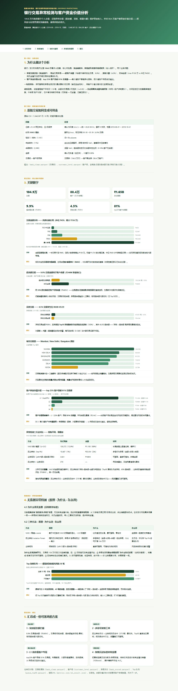

# Bank Transactions — Anomaly Detection & Customer Value

**The business problem.** A bank / payment processor sees ~1M personal
transactions a day. Some leak money through fraud, over-limit, or operational
error — but without labels nobody knows *which* to review first, or *where* the
risk and value actually sit. This project detects anomalies on **real** Indian
bank transaction data (1,048,567 rows, 884,265 customers, Aug–Oct 2016) to
**protect revenue**, and tiers customers by money value to focus resources.

## What it does

- Cleans a messy real export: two-digit `d/m/yy` dates, `HHMMSS` times,
  missing/invalid gender, missing balances. Builds transaction-level and
  customer-level tables.
- **Anomaly detection (unsupervised — no fraud labels)**:
  - MAD / robust z-score baseline (interpretable, but noisy on this heavy tail).
  - **Isolation Forest** on multi-dim features (log amount, hour, over-balance,
    late-night, balance) → Top 1% review queue.
  - Business rule (p99 large amount AND over-balance/late-night) — directly
    deployable.
- **Customer money-value tiers**: top 25% of customers drive **~81% of
  transaction value**.

## Honest notes

- Each customer averages only **1.19 transactions** and balance is **not**
  correlated with cumulative transactions (r=0.06) → **a real balance
  reconciliation is impossible** on this data; I do transaction-level anomaly
  detection instead and say so.
- No fraud labels → unsupervised only. **No deep learning**: anomaly detection
  must answer "why is this flagged" (compliance/customer service), and trees /
  density methods already scale to 1M rows and stay interpretable — DL gains
  little here (same rule as my other projects).
- MAD flags 69% of money (too noisy); Isolation Forest flags 1% of transactions
  (2% of money); business rule flags 3,921 high-amount risky txns (₹186M). The
  three overlap only at 370 — **signals must be combined**, not relied on alone.
- Balance ledger reconciliation needs multi-period per-account data — next step.

## Key verified numbers

- 1,048,567 transactions / 884,265 customers; 83.8% single-transaction
- Amount median ₹459, P99 ₹20K, max ₹1.56M (heavy right tail)
- Over-balance: 103,549 txns (9.9%), ₹346M
- Late-night (00:00–05:59): 47,031 txns (4.5%), ₹56M
- Top review queue (IF top50): ₹295K, all late-night, 45/50 over-balance
- Customer tiers: L1 (top25%) → 81% of value, mean balance ₹214K

## Report preview



> Full interactive report: `报告/银行交易异常检测与客户资金价值分析.html` — GitHub doesn't render HTML; open locally after cloning.

## Layout

```
scripts/ explore_data.py / clean_data.py / analyze.py / ml_analysis.py
tests/   test_cleaning.py, test_report_numbers.py
报告/   银行交易异常检测与客户资金价值分析.html  (green-amber theme, each chart Insight+Action)
```

## Run it

```bash
python -m venv .venv && .venv\Scripts\activate
pip install -r requirements.txt
python scripts/clean_data.py
python scripts/analyze.py
python scripts/ml_analysis.py
pytest tests/ -q
```

## Data source

The raw file lives in `data/raw/` (excluded from git — after cloning, download it yourself).

| File | What it is | Kaggle download |
|---|---|---|
| `bank_transactions.csv` | Indian personal transactions, 1,048,567 rows, Aug–Oct 2016 | `kaggle datasets download -d shivamb/bank-customer-segmentation -p data/raw --unzip` |

Kaggle page: https://www.kaggle.com/datasets/shivamb/bank-customer-segmentation

```bash
pip install kaggle
kaggle datasets download -d shivamb/bank-customer-segmentation -p data/raw --unzip
# requires a kaggle.json / KAGGLE_USERNAME + KAGGLE_KEY
```

— Jiawei Wang
