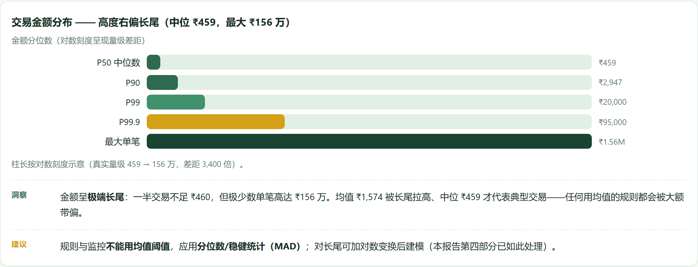
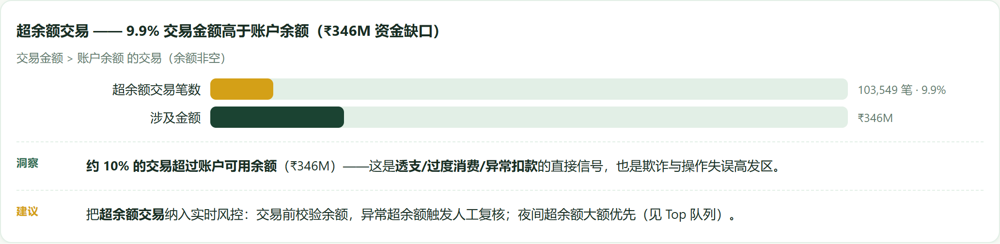
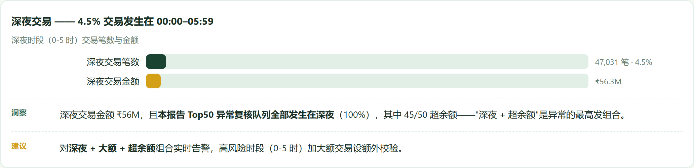
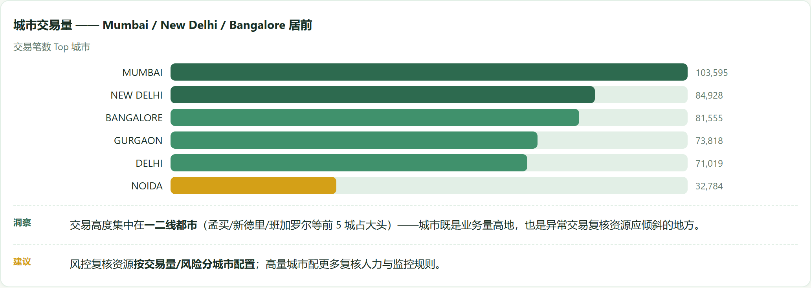
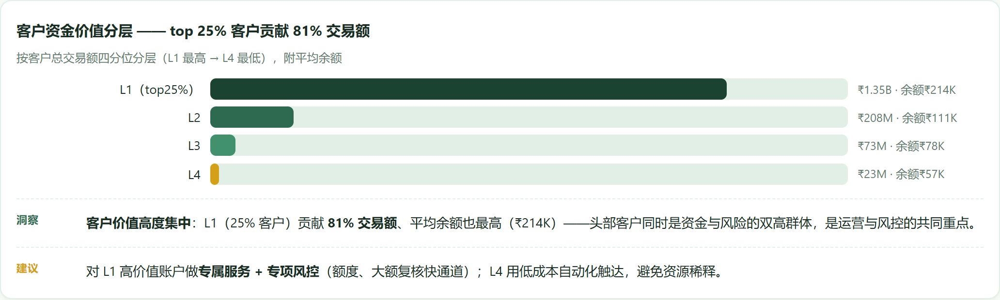
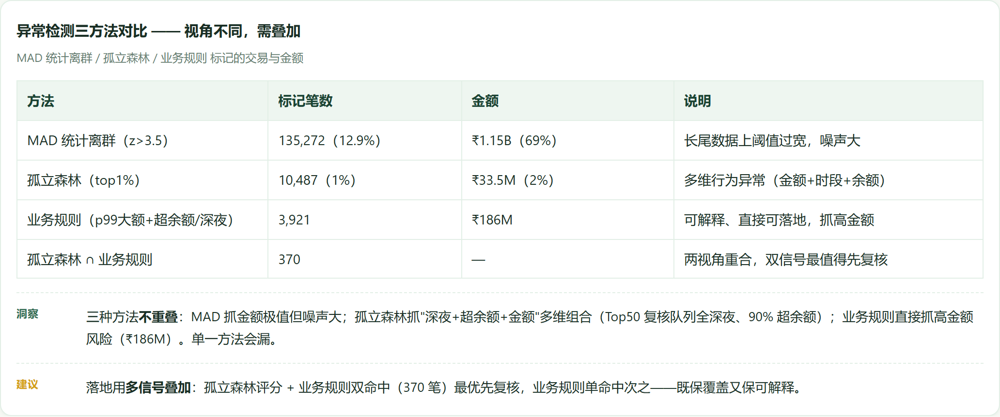
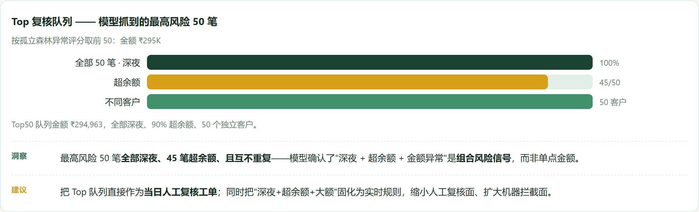

# 银行交易异常检测与客户资金价值分析（Bank Transaction Anomaly Detection & Customer Value）


> 项目目标：在约 100 万条真实个人交易上，识别哪些交易最可能"漏钱"（欺诈/超限/操作错误）、优先复核哪些，并按资金价值分层客户以集中资源。
> 数据：真实印度银行个人交易（1,048,567 行、884,265 名客户，2016-08 ~ 2016-10）。

## 一、业务背景与目的

银行/支付机构每天见约 100 万条个人交易，一部分通过欺诈、超限或操作错误漏钱——但没有标签，没人知道**先复核哪些**、风险和价值到底在哪。本项目在真实数据上做交易级异常检测以**保护收入**，并按资金价值给客户分层以聚焦资源。

## 二、数据清洗与预处理

- 清洗脏乱真实导出：两位年份 `d/m/yy` 日期、`HHMMSS` 时间、性别缺失/无效、余额缺失。
- 构建交易级与客户级两层表；派生小时、深夜标志、是否超余额、金额对数等特征。

## 三、关键指标

| 指标 | 数值 |
|---|---|
| 规模 | 1,048,567 笔 / 884,265 客户；83.8% 单笔客户 |
| 金额分布 | 中位数 ₹459，P99 ₹20K，最大 ₹1.56M（重右尾） |
| 超余额 | 103,549 笔（9.9%），₹346M |
| 深夜(00:00–05:59) | 47,031 笔（4.5%），₹56M |
| 客户资金价值 | L1（top 25%）→ **81% 的交易价值**，平均余额 ₹214K |

## 四、建模（无监督——无欺诈标签）

三法对比，覆盖与重叠都如实报告：
- **MAD / 稳健 z 分数**：可解释，但在这重尾上太吵（标记了 69% 的钱）。
- **孤立森林（Isolation Forest）**：多特征（log 金额、小时、超余额、深夜、余额）→ top 1% 复核队列。
- **业务规则**（p99 大金额 且 超余额/深夜）：3,921 笔高风险交易（₹186M），可直接落地。

**关键结论**：三法重叠仅 **370**——**信号必须组合，不能单独依赖任何一种**。

**为什么不用深度学习**：异常检测必须能回答"为什么标记这条"（合规/客服），树/密度方法已能处理百万行且保持可解释；DL 在此增益极小。且每客户仅 1.19 笔、余额与累计交易相关仅 0.06 → **真实余额勾稽在此数据上不可能**，所以做交易级异常检测并如实说明。

## 五、图表









> 完整交互版报告：`report/银行交易异常检测与客户资金价值分析.html`——GitHub 不渲染仓库内 HTML，clone 后本地打开。

## 六、数据来源

原始数据在项目内 `data/raw/`（不入 git——clone 后请自行下载）。

| 文件 | 说明 | Kaggle 下载 |
|---|---|---|
| `bank_transactions.csv` | 印度个人交易，1,048,567 行，2016-08~10 | `kaggle datasets download -d shivamb/bank-customer-segmentation -p data/raw --unzip` |

Kaggle 页面：https://www.kaggle.com/datasets/shivamb/bank-customer-segmentation

```bash
pip install kaggle
kaggle datasets download -d shivamb/bank-customer-segmentation -p data/raw --unzip
# 需要 kaggle.json / KAGGLE_USERNAME + KAGGLE_KEY 认证
```

## 七、运行方式

```bash
pip install -r requirements.txt
python scripts/clean_data.py
python scripts/analyze.py
python scripts/ml_analysis.py
pytest tests/ -q
```

## 八、诚实边界

- 无欺诈标签 → 只有无监督方法；余额台账勾稽需多期逐账户数据——列为下一步。
- 三法必须组合，单靠任一种会漏或误报。

— Jiawei Wang

## CI / 质量门

每次 push 或拉取请求都会触发 [GitHub Actions](.github/workflows/ci.yml) 工作流：质量门检查「英文文档不含中文、引用的图表都存在、中英 README 与 index 齐全」，随后运行 `pytest` 测试套件。


